# Sistema de Préstamo de Libros — Microservicios con Quarkus

Proyecto multi-módulo Maven compuesto por **tres microservicios reactivos** construidos con **Quarkus 3.39.5** y **Java 25**, que colaboran para gestionar un catálogo de libros, registrar órdenes de préstamo y auditar cada operación de forma asíncrona mediante **Apache Kafka**.

| Microservicio | Puerto | Responsabilidad | Persistencia | Comunicación |
|---|---|---|---|---|
| `ms-book-availability-checker` | `8082` | Catálogo de libros y control de stock | PostgreSQL (`books_db`) | Expone API REST |
| `ms-book-loan` | `8083` | Creación y consulta de órdenes de préstamo | MySQL (`loans_db`) | Consume REST + produce eventos Kafka |
| `ms-auditor` | — (sin API REST) | Registro de auditoría | MongoDB (`audit_log_db`) | Consume eventos Kafka |

---

## Índice

1. [Arquitectura global](#1-arquitectura-global)
2. [Flujo global entre microservicios](#2-flujo-global-entre-microservicios)
3. [ms-book-availability-checker](#3-ms-book-availability-checker)
4. [ms-book-loan](#4-ms-book-loan)
5. [ms-auditor](#5-ms-auditor)
6. [Infraestructura (docker-compose)](#6-infraestructura-docker-compose)
7. [Cómo ejecutar](#7-cómo-ejecutar)
8. [Consideraciones conocidas](#8-consideraciones-conocidas)

---

## 1. Arquitectura global

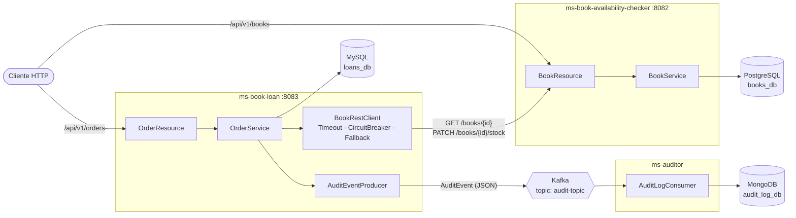

**Estilo de comunicación**

- **Síncrona (REST):** `ms-book-loan` → `ms-book-availability-checker`, usando MicroProfile Rest Client reactivo (`Uni<T>`).
- **Asíncrona (eventos):** `ms-book-loan` → Kafka → `ms-auditor`, usando SmallRye Reactive Messaging.
- **Base de datos por servicio:** cada microservicio es dueño exclusivo de su almacenamiento (PostgreSQL, MySQL y MongoDB).

---

## 2. Flujo global entre microservicios

El caso de uso principal es **crear una orden de préstamo**. Involucra a los tres microservicios:

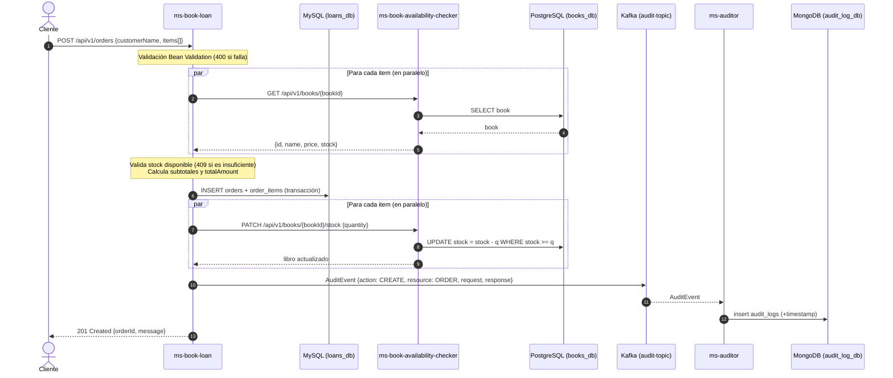

> La publicación en Kafka desacopla la auditoría: `ms-auditor` procesa el evento de forma independiente y su disponibilidad no bloquea la respuesta al cliente más allá del `ack` del broker (`acks=1`).

---

## 3. ms-book-availability-checker

Servicio dueño del **catálogo de libros** y de su **inventario**. Expone un CRUD completo más una operación atómica para descontar stock.

**Stack:** Quarkus REST + Jackson · Hibernate Reactive Panache · Reactive PG Client · Hibernate Validator · MapStruct · Lombok · SmallRye OpenAPI · SmallRye Health.

### 3.1 Modelo de datos

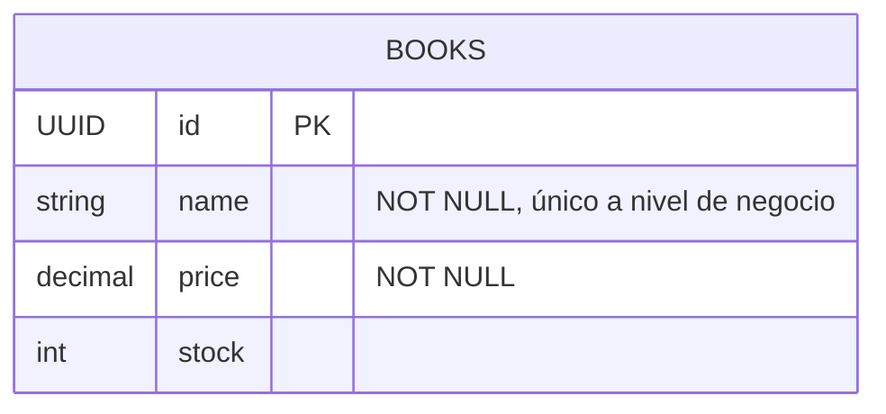

Al iniciar, `import.sql` carga 10 libros de ejemplo (*Clean Code*, *Effective Java*, *Domain-Driven Design*, etc.). El esquema se recrea en cada arranque (`drop-and-create`).

### 3.2 Endpoints — `/api/v1/books`

| Método | Ruta | Descripción | Respuesta OK | Errores |
|---|---|---|---|---|
| `GET` | `/` | Lista paginada (`page`=0, `size`=10, `sort`=`name`) | `200` `PaginatedResponseDto<BookDto>` | — |
| `GET` | `/{id}` | Obtiene un libro por UUID | `200` `BookDto` | `404` |
| `POST` | `/` | Crea un libro | `201` (sin cuerpo) | `400` validación, `409` nombre duplicado |
| `PUT` | `/{id}` | Actualiza nombre, precio y stock | `200` | `400`, `404` |
| `PATCH` | `/{id}/stock` | Descuenta stock `{ "quantity": n }` | `200` `BookDto` | `400`, `404`, `409` stock insuficiente |
| `DELETE` | `/{id}` | Elimina un libro | `204` | `404` |

**Validaciones (`BookRequestDto`)**: `name` obligatorio (2–60 caracteres), `price` obligatorio, `stock` ≥ 1. En `StockDecreaseRequestDto`, `quantity` obligatorio y > 0.

### 3.3 Flujo: crear libro

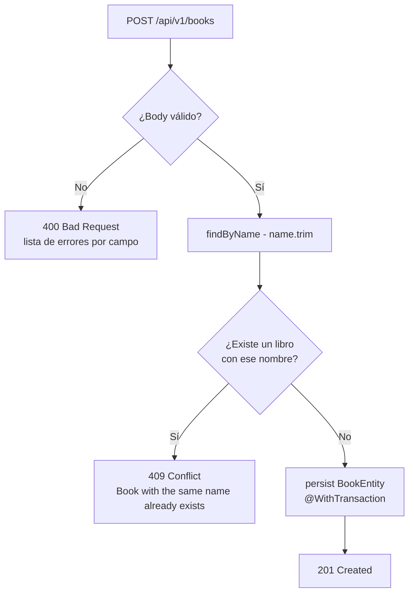

### 3.4 Flujo: descontar stock (operación atómica)

El descuento se realiza con **un único `UPDATE` condicional**, lo que evita condiciones de carrera entre préstamos concurrentes:

```sql
UPDATE books SET stock = stock - :q WHERE id = :id AND stock >= :q
```

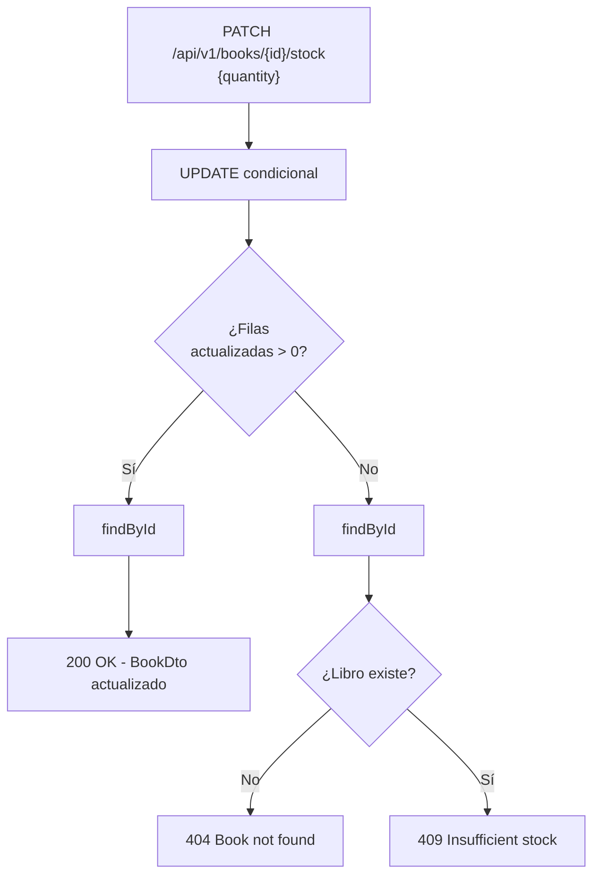

### 3.5 Flujo: consulta paginada

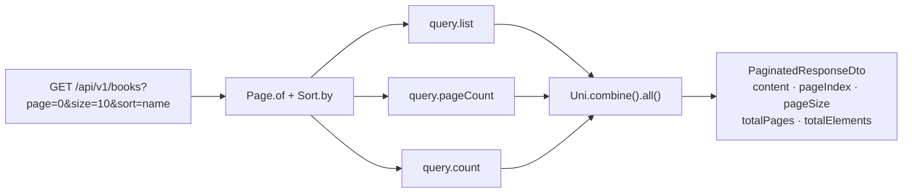

**Ejemplo de respuesta**

```json
{
  "content": [
    { "id": "a3f60d90-e52b-4a97-a6dd-81ff7e5b4101", "name": "Clean Code", "price": 45.90, "stock": 12 }
  ],
  "pageIndex": 0,
  "pageSize": 10,
  "totalPages": 1,
  "totalElements": 10
}
```

**Formato de error**

```json
{ "status": 409, "message": "Insufficient stock" }
```

---

## 4. ms-book-loan

Servicio **orquestador** de las órdenes de préstamo. Consulta libros y descuenta stock en `ms-book-availability-checker`, persiste la orden en MySQL y publica un evento de auditoría en Kafka.

**Stack:** Quarkus REST + Jackson · Hibernate Reactive Panache · Reactive MySQL Client · REST Client · SmallRye Fault Tolerance · Messaging Kafka · Micrometer/Prometheus · Hibernate Validator · MapStruct · Lombok · OpenAPI · Health.

### 4.1 Modelo de datos (maestro–detalle)

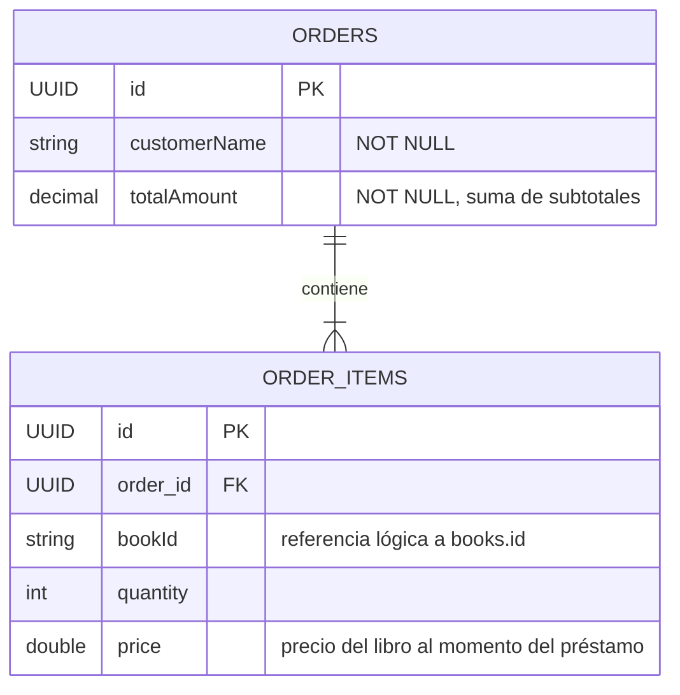

`bookId` es una **referencia lógica** (no hay FK entre bases de datos); el precio se copia al ítem para conservar el valor histórico.

### 4.2 Endpoints — `/api/v1/orders`

| Método | Ruta | Descripción | Respuesta OK | Tolerancia a fallos |
|---|---|---|---|---|
| `GET` | `/` | Lista paginada (`page`=0, `size`=10, `sort`=`id`) | `200` `PaginatedResponseDto<OrderResponse>` | — |
| `GET` | `/{id}` | Obtiene una orden con sus ítems y nombres de libro | `200` `OrderResponse` | `@Timeout(10s)`, `@Retry(2)`, `@CircuitBreaker` |
| `POST` | `/` | Crea una orden de préstamo | `201` `CreatedOrderResponse` | `@Timeout(10s)`, `@CircuitBreaker` |

**Ejemplo de petición**

```http
POST http://localhost:8083/api/v1/orders
Content-Type: application/json

{
  "customerName": "Ana Pérez",
  "items": [
    { "bookId": "a3f60d90-e52b-4a97-a6dd-81ff7e5b4101", "quantity": 2 },
    { "bookId": "bc8b723e-bcef-4eb8-90af-6d299b49e022", "quantity": 1 }
  ]
}
```

**Respuesta `201 Created`**

```json
{ "orderId": "5b0e…", "message": "Order created successfully" }
```

**Validaciones (`OrderRequest`)**: `customerName` obligatorio, `items` no vacío; cada ítem requiere `bookId` y `quantity` > 0.

### 4.3 Flujo: crear orden (pipeline reactivo)

`OrderService.save()` encadena los pasos dentro de una transacción (`@WithTransaction`):

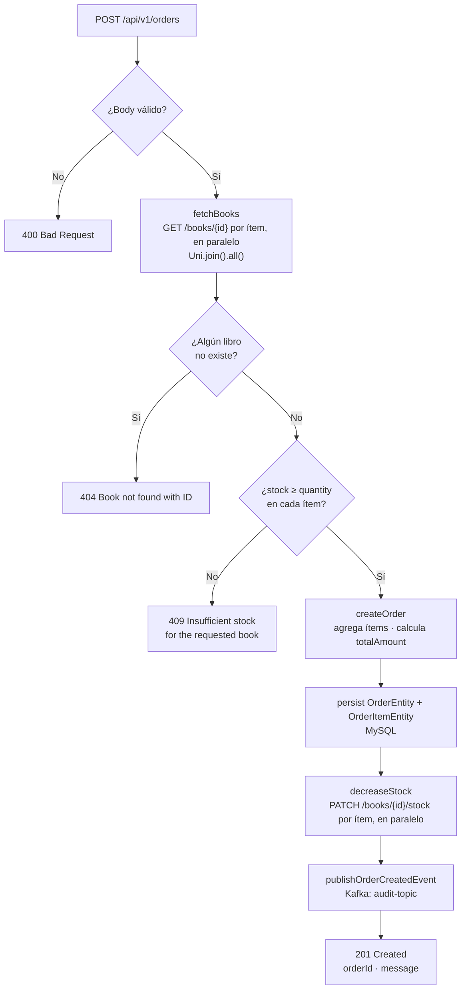

### 4.4 Flujo: consultar orden por ID

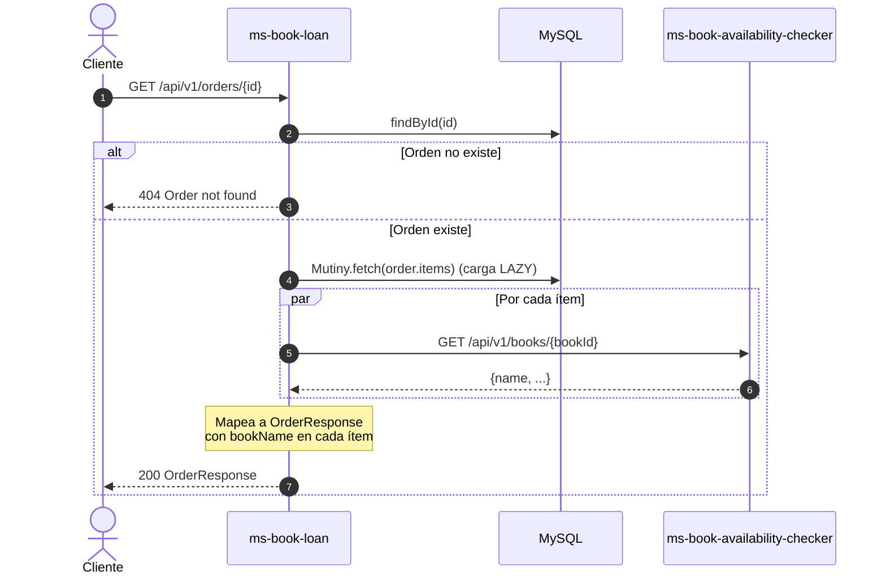

### 4.5 Resiliencia en la llamada a `ms-book-availability-checker`

`BookRestClient.findById` está protegido con **Timeout (2 s)**, **Circuit Breaker** (4 peticiones, 50 % de fallos, 10 s abierto) y **Fallback**:

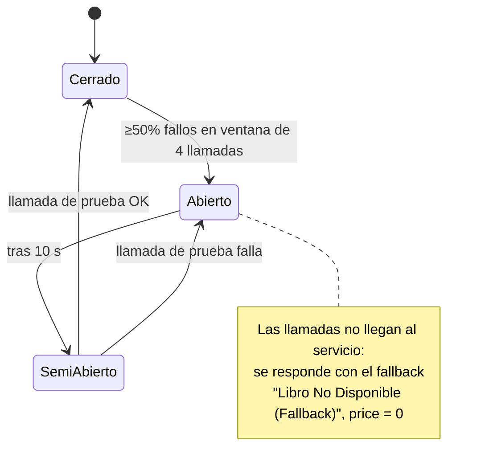

A nivel de endpoint, `OrderResource` añade su propio `@CircuitBreaker` (10 peticiones, 50 %) y, en `GET /{id}`, `@Retry` (2 reintentos, 200 ms ± 100 ms). Ambos **ignoran las excepciones de negocio** (`CustomBusinessException`: 404/409) para no reintentar ni abrir el circuito por errores del cliente.

### 4.6 Evento de auditoría publicado

```json
{
  "action": "CREATE",
  "resource": "ORDER",
  "request": "{\"customerName\":\"Ana Pérez\",\"items\":[...]}",
  "response": "{\"orderId\":\"5b0e…\",\"customerName\":\"Ana Pérez\",\"totalAmount\":146.30}"
}
```

Serializado con `ObjectMapperSerializer` en el canal `audit-topic` (`acks=1`).

### 4.7 Observabilidad

- **Métricas Micrometer** (exportadas a Prometheus en `/q/metrics`):
  `orders.get.all.timer|count`, `orders.get.byid.timer|count`, `orders.save.timer|count`.
- **Health checks:** `/q/health/live` (también en `ms-book-availability-checker`).
- **OpenAPI / Swagger UI:** `/q/openapi` y `/q/swagger-ui` (en modo dev).

### 4.8 Configuración relevante

| Propiedad | Valor por defecto |
|---|---|
| `quarkus.datasource.reactive.url` | `mysql://localhost:3307/loans_db` (`DB_HOST`, `DB_PORT`) |
| Datasource `loans-backup` | `mysql://localhost:3305/loans_db_bk` (`DB_BACKUP_PORT`) |
| Perfil `%qa` | `LOANS_DB_QA_URL`, `LOANS_DB_QA_USERNAME`, `LOANS_DB_QA_PASSWORD`, `LOANS_DB_BK_QA_URL` |
| `quarkus.rest-client.book-availability-checker-api.url` | `http://localhost:8082` |
| `kafka.bootstrap.servers` | `localhost:29092` (`KAFKA_BOOTSTRAP_SERVERS`) |

---

## 5. ms-auditor

Servicio **consumidor de eventos**. No expone endpoints REST: escucha el tópico `audit-topic` y guarda cada evento en MongoDB, añadiendo la marca de tiempo de recepción.

**Stack:** Quarkus Messaging Kafka · MongoDB Panache (reactivo) · Jackson.

### 5.1 Modelo de datos

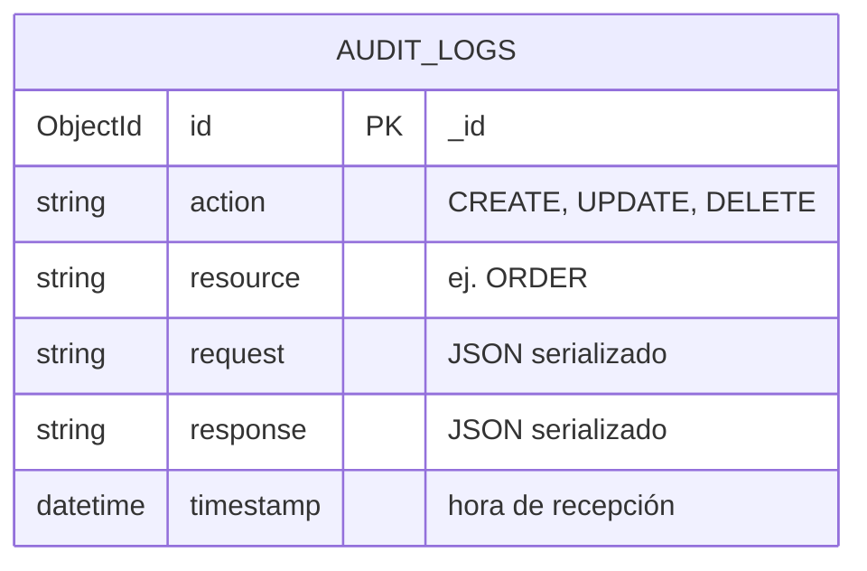

### 5.2 Flujo: consumo y persistencia

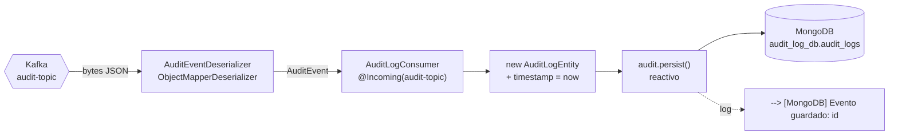

- `auto.offset.reset=earliest`: al iniciar por primera vez procesa todos los eventos pendientes del tópico.
- El método devuelve `Uni<Void>`; el offset se confirma cuando la escritura en MongoDB termina.

**Documento resultante**

```json
{
  "_id": { "$oid": "6650…" },
  "action": "CREATE",
  "resource": "ORDER",
  "request": "{\"customerName\":\"Ana Pérez\",\"items\":[...]}",
  "response": "{\"orderId\":\"5b0e…\",\"customerName\":\"Ana Pérez\",\"totalAmount\":146.30}",
  "timestamp": "2026-10-03T10:15:42.123"
}
```

---

## 6. Infraestructura (docker-compose)

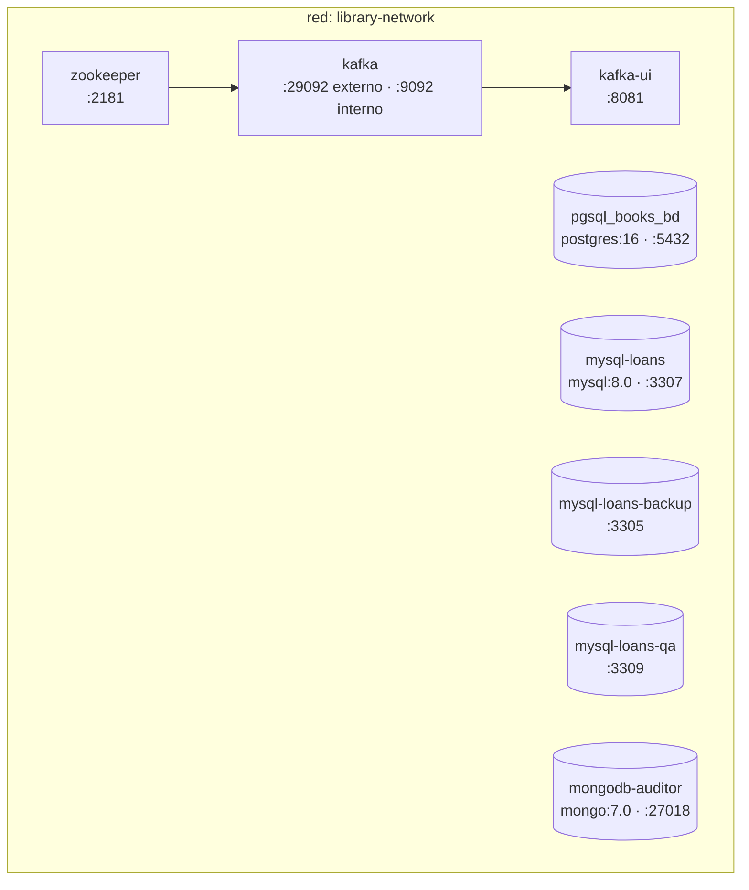

| Servicio | Imagen | Puerto host | Usado por |
|---|---|---|---|
| `zookeeper` | `confluentinc/cp-zookeeper:7.0.1` | 2181 | Kafka |
| `kafka` | `confluentinc/cp-kafka:7.0.1` | 29092 | `ms-book-loan`, `ms-auditor` |
| `kafka-ui` | `provectuslabs/kafka-ui` | 8081 | Inspección de tópicos |
| `pgsql_books_bd` | `postgres:16` | 5432 | `ms-book-availability-checker` |
| `mysql-loans` | `mysql:8.0` | 3307 | `ms-book-loan` |
| `mysql-loans-backup` | `mysql:8.0` | 3305 | `ms-book-loan` (datasource `loans-backup`) |
| `mysql-loans-qa` | `mysql:8.0` | 3309 | `ms-book-loan` (perfil `qa`) |
| `mongodb-auditor` | `mongo:7.0` | 27018 | `ms-auditor` |

---

## 7. Cómo ejecutar

**Requisitos:** JDK 25, Docker y Docker Compose (Maven Wrapper incluido en cada módulo).

```bash
# 1. Levantar la infraestructura
docker compose up -d

# 2. Arrancar cada microservicio en modo dev (en terminales separadas)
cd ms-book-availability-checker && ./mvnw quarkus:dev   # :8082
cd ms-book-loan                 && ./mvnw quarkus:dev   # :8083
cd ms-auditor                   && ./mvnw quarkus:dev   # consumidor Kafka
```

> Todos los servicios intentan usar el puerto de depuración `5005` en modo dev; si choca, arranca los demás con `-Ddebug=<otro-puerto>` o `-Ddebug=false`.

**Prueba rápida del flujo completo**

```bash
# Crear una orden con libros precargados
curl -X POST http://localhost:8083/api/v1/orders \
  -H "Content-Type: application/json" \
  -d '{"customerName":"Ana Pérez","items":[{"bookId":"a3f60d90-e52b-4a97-a6dd-81ff7e5b4101","quantity":2}]}'

# Verificar el stock descontado (12 → 10)
curl http://localhost:8082/api/v1/books/a3f60d90-e52b-4a97-a6dd-81ff7e5b4101

# Ver el evento en Kafka UI → http://localhost:8081  (tópico audit-topic)
# Ver el registro en MongoDB
docker exec -it mongodb-auditor mongosh audit_log_db --eval "db.audit_logs.find().pretty()"
```

---

## 8. Consideraciones conocidas

Comportamientos del código actual que conviene tener presentes:

- **Sin compensación (Saga) en el descuento de stock.** El stock se descuenta en `ms-book-availability-checker` después de persistir la orden. Si un `PATCH` falla (o falla el envío a Kafka), la transacción de MySQL se revierte, pero los descuentos de stock que ya se aplicaron en otros ítems **no se restauran**.
- **El fallback enmascara caídas como "stock insuficiente".** Cuando `ms-book-availability-checker` no responde, el fallback devuelve un libro con `stock = null`, por lo que la creación de la orden responde `409 Insufficient stock` en lugar de un error de disponibilidad (`503`).
- **Llamadas N+1 al consultar órdenes.** `GET /api/v1/orders` consulta el nombre de cada libro de cada ítem vía REST.
- **Datasource `loans-backup` configurado pero sin uso** en el código actual.
- **Esquemas recreados en cada arranque** (`drop-and-create`) en PostgreSQL y MySQL: los datos no persisten entre reinicios de los servicios.
